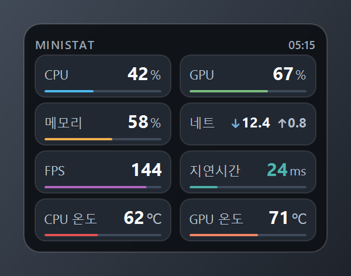
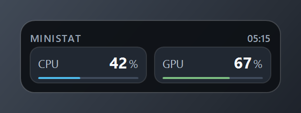

# MiniStat

Windows용 초소형 시스템 모니터 오버레이입니다. 창 테두리도 탭도 없이 둥근 카드 하나만 뜨고, 8가지 지표를 1초마다 갱신합니다. 보조 모니터 한쪽에 띄워 두고 쓰도록 만들었습니다.

A tiny borderless system-monitor overlay for Windows: one card, eight live metrics, no installer.



## 표시 항목

| 항목 | 내용 |
| --- | --- |
| CPU | 전체 사용률 |
| GPU | 사용률 (NVIDIA NVML) |
| 메모리 | 사용률, 사용/전체 GB |
| 네트워크 | 다운로드·업로드 속도 (Mbps) |
| FPS | 게임 프레임 (PresentMon) |
| 지연시간 | 1.1.1.1 기준 ms |
| CPU 온도 | LibreHardwareMonitor → ACPI 열 센서 순 |
| GPU 온도 | NVIDIA NVML |

## 빠른 시작

1. 아래 [빌드](#빌드)로 실행 파일을 만들고 `build\MiniStat\MiniStat.exe`를 실행합니다. 관리자 권한 확인 창이 한 번 뜨니 "예"를 누릅니다.
2. 카드를 끌어 원하는 자리에 놓습니다. 놓은 위치는 저장됩니다.
3. 우클릭으로 설정을 바꾸고, 트레이 아이콘으로 숨기기·보이기를 합니다.

관리자 권한이 필요한 이유는 CPU 온도(커널 드라이버)와 FPS(ETW 추적)입니다. "아니오"를 고르면 실행되지 않습니다.

## 요구 사항

- Windows 10 / 11
- .NET Framework 4.8 (Windows에 기본 포함, 별도 설치 불필요)
- 관리자 권한
- 선택 사항: NVIDIA GPU(GPU 지표), [PresentMon](https://github.com/GameTechDev/PresentMon)(FPS)

## 조작

- **왼쪽 버튼 드래그**: 창 이동 (놓은 위치 저장)
- **우클릭**: 설정 메뉴
  - 새로 고침: 0.5초 / 1초 / 2초
  - 배율: 100% / 125% / 150%
  - 투명도: 95% / 90% / 80% / 70% / 50%
  - 표시 방식: 전체 표시 / 2칸 (고정) / 2칸 (마우스 올리면 전체)
  - 항상 위, Windows 시작 시 자동 실행, 클릭 통과
  - 보조 모니터로 이동 / 주 모니터로 이동 / 위치 초기화
  - 화면에 붙이기: 왼쪽 위·위 가운데·오른쪽 위·왼쪽 가운데·화면 가운데·오른쪽 가운데·왼쪽 아래·아래 가운데·오른쪽 아래
- **트레이 아이콘**: 더블클릭으로 보이기/숨기기, 우클릭 메뉴는 카드와 같은 항목을 제공합니다.

클릭 통과를 켜면 마우스가 창을 그대로 지나가서 카드에서 우클릭 메뉴를 열 수 없습니다. 이때는 **Ctrl+Alt+M**을 누르거나 트레이 아이콘 우클릭 → **클릭 통과**의 체크를 풉니다. Ctrl+Alt+M이 다른 프로그램에 잡혀 있으면 Ctrl+Alt+Shift+M, Ctrl+Alt+H 순으로 자동 대체되고, 실제로 쓰이는 조합이 메뉴에 표시됩니다.

## 2칸 모드

표시 방식을 **2칸**으로 바꾸면 카드가 두 칸만 남기고 접히며 높이가 73픽셀로 줄어듭니다. 남은 두 칸은 4초마다 CPU·GPU → 메모리·네트 → FPS·지연시간 → CPU·GPU 온도 순으로 넘어가므로, 시간이 지나면 8개 값을 모두 볼 수 있습니다.

**2칸 (마우스 올리면 전체)**는 카드 위에 커서가 있을 때만 여덟 칸으로 펼칩니다. 아래 공간이 있으면 아래로 자라고, 화면 아래쪽에 붙여 두었다면 아래 모서리를 고정한 채 위로 펼쳐져서 접힌 두 칸은 움직이지 않습니다. 클릭 통과 상태에서도 똑같이 동작합니다.



배치는 끌어다 놓거나 **화면에 붙이기**로 맞춥니다. 붙이기는 현재 모니터 기준 9개 위치에 가장자리에서 24픽셀 떨어져 배치하며, 아래 줄에 붙이면 위로, 위 줄에 붙이면 아래로 펼쳐집니다.

## 자동 실행

우클릭 메뉴의 **Windows 시작 시 자동 실행**을 체크하면 Windows 작업 스케줄러에 `MiniStat` 작업이 등록되고, 다음 로그온부터 관리자 권한으로 UAC 창 없이 시작됩니다. 데스크톱이 준비되기 전에 실행되면 로더 단계에서 종료되는 경우가 있어 **로그온 30초 후**에 시작하고, 실패하면 30초 간격으로 3번까지 다시 시도합니다.

- 해제는 같은 항목의 체크를 풉니다.
- 앱 폴더를 옮기면 등록 경로가 달라지므로 새 위치에서 다시 체크합니다.
- 직접 지우려면 관리자 명령 프롬프트에서 `schtasks /Delete /TN MiniStat /F`.

## 크기와 배율

기본 카드는 260 × 196픽셀이고 2칸 모드에서는 260 × 73입니다. 배율 125%·150% 모니터에서는 그 배율의 실제 픽셀 크기로 글자를 다시 그리므로 확대해도 흐려지지 않습니다. 카드 모서리는 픽셀 단위 투명도로 그려 밝은 배경 위에서도 계단 현상이 없습니다.

## FPS

FPS는 인텔 PresentMon이 수집합니다. 앱에 포함되어 있지 않고, 아래 위치에 있으면 자동으로 찾습니다.

- `C:\Program Files\NVIDIA Corporation\FrameViewSDK\bin\PresentMon_x64.exe` (NVIDIA FrameView SDK)
- `C:\Program Files\PresentMon\PresentMon.exe`
- `MiniStat.exe`와 같은 폴더 또는 그 아래 `tools\` 폴더의 `PresentMon_x64.exe`

| 표시 | 뜻 | 해결 |
| --- | --- | --- |
| `대기` | 게임 프레임이 아직 없음 | 게임 실행 |
| 숫자 | 현재 FPS | — |
| `없음` | PresentMon을 찾지 못함 | 위 경로 중 한 곳에 설치 |
| `관리자 필요` | 권한 없이 실행됨 | 관리자 권한으로 재실행 |
| `실패` | PresentMon이 값을 내지 못함 | 게임을 테두리 없음 창 모드로, 다른 캡처 프로그램 종료 |
| `재시도` / `재시작` | 자동 재시작 중 | 잠시 대기 |

독점 전체 화면 게임은 프레임이 잡히지 않을 수 있습니다. 게임 설정에서 테두리 없음 창 모드로 바꾸면 대부분 해결됩니다.

## CPU 온도와 GPU

CPU 온도는 함께 들어 있는 `LibreHardwareMonitorLib.dll`(커널 드라이버, AMD는 Tctl/Tdie 기준)을 먼저 시도하고, 실패하면 Windows ACPI 열 센서, 성능 카운터 순으로 내려갑니다. 모두 실패하면 `센서 없음`으로 표시되고, 그동안 `%LOCALAPPDATA%\MiniStat\sensors.log`에 감지된 센서와 실패 이유가 1분에 한 번 기록됩니다.

GPU 사용률과 온도는 NVIDIA 드라이버의 NVML을 씁니다. NVIDIA GPU가 없으면 GPU 항목이 `—`로 표시됩니다.

## 빌드

```powershell
powershell -ExecutionPolicy Bypass -File .\build.ps1
```

`build\MiniStat\MiniStat.exe`와 라이브러리 DLL 두 개가 생성됩니다. Roslyn C# 컴파일러가 필요하며(Visual Studio Build Tools), 다른 위치에 있으면 `$env:MiniStatCsc`에 `csc.exe` 경로를 지정합니다.

## 파일 구조

```
src/            C# 소스, 매니페스트, 아이콘
lib/            LibreHardwareMonitorLib.dll, HidSharp.dll
docs/           미리보기 이미지
build.ps1       빌드 스크립트
```

## 설정과 로그

- `%APPDATA%\MiniStat\settings.ini` — 위치, 배율, 투명도, 새로 고침 간격, 2칸 모드, 클릭 통과. 지우면 기본값으로 돌아갑니다.
- `%APPDATA%\MiniStat\trace.log` — 창 크기·위치·표시 상태 변화 기록. 카드가 사라져 보일 때 확인용입니다.
- `%LOCALAPPDATA%\MiniStat\sensors.log`, `error.log` — 센서 진단과 예기치 않은 종료 기록.

## 알려진 제한

- 실행 파일에 코드 서명이 없어 SmartScreen이 경고를 띄울 수 있습니다. **추가 정보 → 실행**으로 진행합니다.
- 관리자 권한으로 실행되지만 하는 일은 센서 읽기와 네트워크 속도·지연시간 측정뿐이고, 디스크에는 위 설정·로그 파일만 씁니다.
- 1초 갱신 기준 메모리 약 130MB, CPU 1% 안팎을 씁니다.
- CPU 온도는 함께 배포하는 LibreHardwareMonitorLib가 WinRing0 계열 커널 드라이버로 읽습니다. Microsoft Defender는 이 계열을 `VulnerableDriver:WinNT/Winring0`으로 분류해 격리할 수 있고, 그러면 온도가 `센서 없음`으로 표시됩니다. 온도가 필요하면 앱 폴더를 Defender 예외로 두고, 원치 않으면 온도 표시를 포기하는 쪽을 택합니다. MiniStat 자체는 별도 드라이버를 설치하지 않습니다.

## 라이선스

이 프로젝트의 소스는 MIT 라이선스를 따릅니다. 함께 배포하는 [LibreHardwareMonitorLib](https://github.com/LibreHardwareMonitor/LibreHardwareMonitor)(MPL-2.0)와 [HidSharp](https://www.zer7.com/software/hidsharp)는 각 원저작자의 라이선스를 따릅니다.

